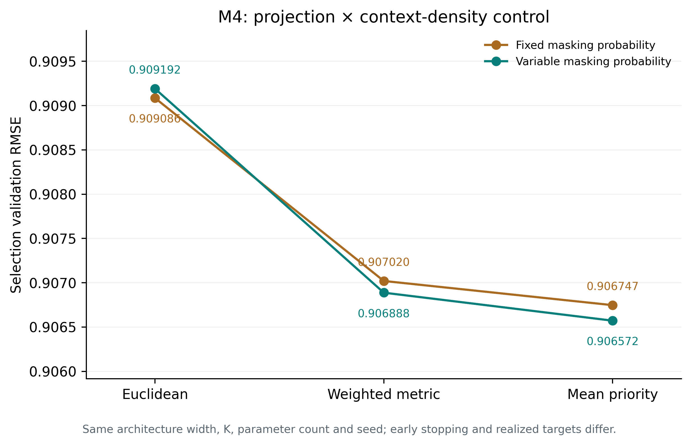
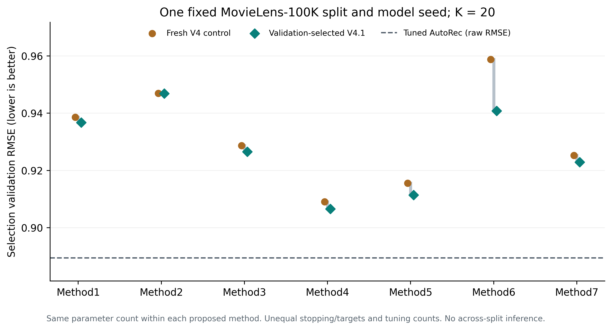

# گزارش بازبینی نسخهٔ ۴٫۱ — بدون کامیت و مرج

شاخهٔ `v4-development` از پایهٔ V3.0.1 با SHA `3b1af9306a9ef9da541c5b0fabbe74dbafeb3011` ساخته شد. تغییرات کد این بسته **کامیت یا push نشده‌اند**؛ شاخهٔ GitHub فعلاً همان پایه را نشان می‌دهد. GitHub برای ذخیرهٔ تغییر محتوای فایل‌ها به commit نیاز دارد. فایل patch و سورس در بستهٔ تحویل، نتیجهٔ قابل بازبینیِ بدون کامیت هستند. هیچ merge انجام نشده است.

هدفِ بهبود شدید TEST در این نوبت اثبات نشده است. خروجی عملی این کار، اصلاحات اجرا و رقبا، بهبودهای اندازه‌گیری‌شدهٔ validation، وزن‌های منتخب با provenance و یک گزارش ریاضی قابل ابطال است. آماده‌بودن برای Q1 یا برتری SOTA نتیجهٔ این پایلوت نیست.

## داده و استقلال شواهد

هر ۱۴۴ آرشیو prediction نسخه‌های ۱، ۲ و ۳ دوباره با float64 محاسبه و بر اساس pair_id با امتیازها و تقسیم مرجع تطبیق داده شدند. ۱۰۰۰۰۰ زوج، ۹۴۳ کاربر و ۱۶۸۲ آیتم موجود است. TRAIN=80053، selection=5980، probability-fit=1993، probability-hold=1994 و TEST=9980 هستند. ولیدیشن نسخه‌های قدیمی روی اشتراک ۵۹۸۰ زوج نیز محاسبه شد؛ مقایسهٔ validation با جمعیت متفاوت به‌عنوان پیشرفت معرفی نشده است.

پیش‌بینی‌های TEST هر هفت رقیب مشترک بین V2 و V3 دقیقاً یکسان‌اند؛ تکرار این اعداد تکرار مستقل آزمایش نیست. اعداد TEST تاریخی در `historical_test_RMSE.csv` صرفاً سابقهٔ مشاهده‌شده‌اند. در آموزش‌های تازه، برچسب‌های TEST واقعی پیش از ساخت مدل NaN شدند و evaluator فقط selection را قبول می‌کرد. **هیچ TEST تازهٔ واقعی در این بازبینی ارزیابی نشده است.** تست‌های واحدِ مصنوعی مستقل از این مطالعه‌اند.

فایل `figures_v1.rar` در دسترس نبود و استفاده نشد؛ برای تکمیل ممیزی شکل‌های نسخهٔ ۱ باید دوباره بارگذاری شود. پیش‌بینی‌های نسخهٔ ۱ در دسترس بودند و ممیزی شدند.

## نتایج تازهٔ هفت مدل

| مدل | ولیدیشن کنترل تازه | ولیدیشن منتخب | بهبود نسبی % | پیکربندی منتخب |
| --- | --- | --- | --- | --- |
| Method1 | 0.938603 | 0.936741 | 0.198 | Method1__density |
| Method2 | 0.946967 | 0.946904 | 0.007 | Method2__density |
| Method3 | 0.928665 | 0.926529 | 0.230 | Method3__density |
| Method4 | 0.909086 | 0.906572 | 0.277 | Method4__priority__density |
| Method5 | 0.915572 | 0.911431 | 0.452 | Method5__density |
| Method6 | 0.958780 | 0.940791 | 1.876 | Method6__decoder_context |
| Method7 | 0.925284 | 0.922883 | 0.259 | Method7__density |

برای هر سطر، عرض شبکه، K=20، تعداد پارامتر، داده و seed کنترل و نسخهٔ منتخب یکسان است. توقف زودهنگام، تعداد هدف‌ها، تعداد candidateها و هزینهٔ OOF/ensemble کاملاً برابر نیستند؛ ستون‌های مصرف واقعی در CSV ثبت شده‌اند. این مطالعه یک split-seed=2026 و یک model-seed=1 روی CPU با یک thread در هر آموزش است. زمان‌های اجرای هم‌زمان مبنای ادعای speedup نیستند. انتخاب بهترین candidate روی همین selection، به خودی خود شاهد تعمیم یا significance نیست.

**روش ۲:** اختلاف بسیار کوچک است و شاهد جهش یا برتری پایدار محسوب نمی‌شود. **روش ۶:** jitter و تغییر مرجع به‌تنهایی سود نداشتند؛ تقویت context دیکودر در مرجع isotropic مفید بود. چند تغییر این بازو را با کنترل اولیه متفاوت کرده‌اند؛ کنترل isotropic جداگانه برای تفکیک بخشی از اثر موجود است. نتایج منفی در `validation_candidates.csv` حفظ شده‌اند.

## تغییرات کد و منطق

* M1 تا M7 همان نام‌های ورودی را در namespace مستقل V4 دارند. entry نسخهٔ ۴ مستقیماً این مدل‌ها را می‌سازد. مسیرهای `run_v2.py`، `run_v3.py` و سورس‌های قدیمی حفظ شده‌اند.
* هدف آموزش می‌تواند روی مخلوطی از تراکم‌های context تعریف شود. حالت jitter=0 مسیر RNG قبلی را حفظ می‌کند. مقدار .15 یعنی احتمال مخفی‌سازی از [.05,.35] می‌آید؛ همهٔ کپی‌های یک زوج با هم حذف می‌شوند. این تغییر اطلاعات یا پارامتر اضافه نمی‌کند، اما تعداد هدف‌های واقعی متفاوت است.
* در M4، readout با اولویت میانگین ابتدا میانگین مجاز و سپس نزدیک‌ترین پراکندگی سازگار با همان میانگین را می‌سازد. مجموعهٔ ممان‌های شدنی ordinal/continuous حفظ می‌شود. projection متریک و Euclidean به‌عنوان کنترل باقی‌اند.
* AutoRec اکنون lr پیکربندی را برای Rprop و Adam واقعاً مصرف می‌کند. مقدار مؤثر قبلی Rprop یعنی .01 صریح شده است؛ بهبود ناشی از regularization را به رفع lr نسبت نمی‌دهیم.
* MBMF در پروتکل common با همان فرمول‌ها و قاعدهٔ پذیرش گام، بهترین snapshot را بر اساس همان selection رقبا انتخاب می‌کند. گزینهٔ `paper` رفتار trainer قبلی را نگه می‌دارد. سیاست checkpoint داخل کلید candidate و checkpoint ثبت می‌شود.
* بودجهٔ MF/BiasMF در V4 با `mf_max_epochs=1000` صریح است. بودجهٔ common MBMF با `mbmf_max_epochs=2000` ثبت می‌شود؛ quick و پروتکل paper بودجهٔ خود را حفظ می‌کنند. بهترین epoch در سقف بودجه، شاهد همگرایی نیست.

شرح انواع، اثبات‌های محدود، موارد شکست، کنترل‌های حذف مکانیسم و منابع اولیه در [گزارش نظری](V4_1_THEORY_FA.md) آمده است. اجزای شناخته‌شدهٔ ridge، denoising، cross-fitting یا projection به‌تنهایی novelty محسوب نمی‌شوند.

## آزمایش تفکیکی M4

| روش فرافکنی / masking | RMSE ولیدیشن | بهترین epoch | گام‌های مصرف‌شده | هدف‌های دیده‌شده |
| --- | --- | --- | --- | --- |
| Method4__control | 0.909086 | 45 | 625.0 | 10006189.0 |
| Method4__density | 0.909192 | 50 | 650.0 | 10317854.0 |
| Method4__metric | 0.907020 | 45 | 625.0 | 10006189.0 |
| Method4__metric__density | 0.906888 | 50 | 650.0 | 10317854.0 |
| Method4__priority | 0.906747 | 45 | 625.0 | 10006189.0 |
| Method4__priority__density | 0.906572 | 50 | 650.0 | 10317854.0 |

کنترل ساده‌تر mean-priority از metric همسو بهتر شد. در نتیجه ادعای ضروری‌بودن metric برای سود نقطه‌ای پشتیبانی نشد. خروجی نقطه‌ای mean-priority به clipped mean head تقلیل می‌یابد؛ آن را قابلیت بیان‌پذیری تازه یا fusion غیرقابل‌تقلیل نمی‌نامیم. نقش dispersion و قیود ممان در regularization و کیفیت احتمال باید جداگانه آزموده شود. شبکه و تعداد پارامتر در شش بازو ثابت‌اند.



## رقبا با همان selection

| رقیب | RMSE خام ولیدیشن | RMSE با کلیپ یکسان | پارامتر کل | بهترین epoch | اجرای منتخب |
| --- | --- | --- | --- | --- | --- |
| AutoRec | 0.889421 | 0.889066 | 944443 | 40 | AutoRec__lambda100.0 |
| BiasMF | 0.937855 | 0.937603 | 55126 | 35 | BiasMF__control |
| MBMF-C | 0.998578 | 0.993707 | 49875 | 560 | MBMF-C__long_budget |
| MBMF-F | 0.937674 | 0.937674 | 49875 | 2000 | MBMF-F__long_budget |
| MBMF-N | 0.939426 | 0.938832 | 49875 | 1280 | MBMF-N__long_budget |
| MF | 0.937485 | 0.933250 | 55126 | 325 | MF__long_budget_wd=0.0001 |

MF با بودجهٔ قبلی در آخرین epoch بهتر می‌شد؛ اجرای طولانی‌تر و regularization روی validation بررسی شد. برای MBMF نیز نمونه‌های طولانی‌تر با initialization منتخب validation اجرا شدند. این‌ها پروتکل common هستند؛ اعداد مقاله‌های اصلی با تقسیم‌های متفاوت مستقیماً هم‌ارز نیستند. بازتولید author-code برای AEMC-NE هنوز تأیید نشده؛ ساختار و دامنهٔ تنظیمات با PDF رسمی ICLR تطبیق داده شدند، اما نتیجهٔ ضعیف پیاده‌سازی موجود برای ادعای شکست روش اصلی کافی نیست.

MBMF-F در اجرای طولانی‌تر نیز بهترین epoch را در سقف ۲۰۰۰ داشت؛ برای آن ادعای همگرایی نمی‌کنیم. بهینه‌ترین مقیاس regularization و تعداد پارامتر برای همهٔ مدل‌ها یکسان نیست. ظرفیت درون هر روش پیشنهادی کنترل شده، اما مقایسهٔ همهٔ خانواده‌ها با پارامتر/compute یکسان در این نوبت انجام نشده است. قید شعاع یا کران خروجی می‌تواند پایداری بدهد و هم‌زمان bias ایجاد کند؛ از آن تضمین برتری RMSE بر MF نتیجه نمی‌شود.

AutoRec تنظیم‌شده با RMSE=0.889421 همچنان از بهترین روش پیشنهادی این پایلوت با RMSE=0.906572 بهتر است. کاهش خطا نسبت به تنظیم ضعیف‌تر AutoRec یا نسبت به MF محدود به ۲۰۰ epoch برای ادعای مقاله کافی نیست. همهٔ رقبا با کلیپ یکسان نیز گزارش شده‌اند؛ خام و کلیپ‌شده در انتخاب یا نتیجه‌گیری مخلوط نشده‌اند.



## احتمال روش ۷

PMF واقعی نسخهٔ منتخب در آرشیو checkpoint ضمیمه است. روی selection، NLL خالص برابر 1.264059، RPS برابر 0.481761 و پوشش بازهٔ گسستهٔ اسمی ۹۰٪ برابر 97.56٪ است. این اعداد روی یک جمعیت ولیدیشن‌اند؛ پوشش گسسته می‌تواند بیش از مقدار اسمی باشد. مرحلهٔ shape از probability-fit/hold مجزا استفاده کرده و میانگین فریز‌شده را تغییر نداده است.

## صحت پیاده‌سازی و وزن‌ها

مجموعهٔ نهایی 241 آزمون را گذرانده است. موارد اصلی شامل عدم استفاده از برچسب TEST در آموزش، حذف زوج هدف از context، checkpoint round-trip، بقای فایل‌های قدیمی، ساخت متراکم/تنک، SPD solver، ممان‌های feasible، بهینگی projection و عدم تغییر میانگین هنگام shape-fit هستند. CUDA واقعی و مطالعهٔ چنددیتاستی اجرا نشده‌اند.

وزن‌های منتخب روی منبع ثابت پژوهش آموزش دیده‌اند. برای استفاده در release، انتقال provenance به‌صورت صریح ثبت شده است: منبع آموزش اولیه، منبع prototype، منبع release و hashهای checkpoint و نتیجه حفظ می‌شوند. پیش‌بینی هر ۵۹۸۰ زوج validation پیش و پس از انتقال تطبیق داده شده و هیچ optimizer step یا TEST واقعی در انتقال اجرا نشده است. این انتقال به‌عنوان آموزش مجدد با hash تازه معرفی نمی‌شود. جزئیات کنار هر وزن در فایل `.provenance.json` موجود است.

## اجرای منتخب و مطالعهٔ بعدی

پس از اعمال patch فقط روی شاخهٔ نسخهٔ ۴:

```bash
python verify_v4.py --require-uncommitted-base
python -m pytest tests -q -p no:cacheprovider
python run_v4.py main --datasets ml-100k --k 20 --split-seeds 2026 --model-seeds 1 --v4-config examples/v4/reviewed_ml100k.json --output results_v4_reviewed
```

دستور `main` روال عادی locked-test را اجرا می‌کند؛ برای ادامهٔ تنظیم پارامترها از `scan` و validation-only استفاده کنید و پس از مشاهدهٔ تست تنظیم را ادامه ندهید. محاسبات این گزارش از pilotهای validation-only آمده‌اند، نه از اجرای دستور main بالا. تنظیمات JSON انتخاب‌شدهٔ یک split هستند و به‌عنوان optimum عمومی همهٔ دیتاست‌ها عرضه نمی‌شوند.

برای مقاله، مطالعهٔ تفکیکی هم‌ظرفیت/هم‌هدف، تنظیم قوی MF/AutoRec/MBMF و سایر رقبا، چند split و seed از پیش ثابت و holdout نهاییِ مشاهده‌نشده لازم است. اثر capacity، تعداد هدف و تعداد تلاش تنظیم باید جدا گزارش شود. همهٔ نتایج منفی و موارد رسیدن به سقف بودجه باید در گزارش بمانند.

تعداد candidateهای تازهٔ این بسته: 41. شواهد این نوبت **اکتشافی** هستند؛ آزمون واقعیِ قبلاً مشاهده‌شده را دوباره confirmatory نمی‌نامیم.
